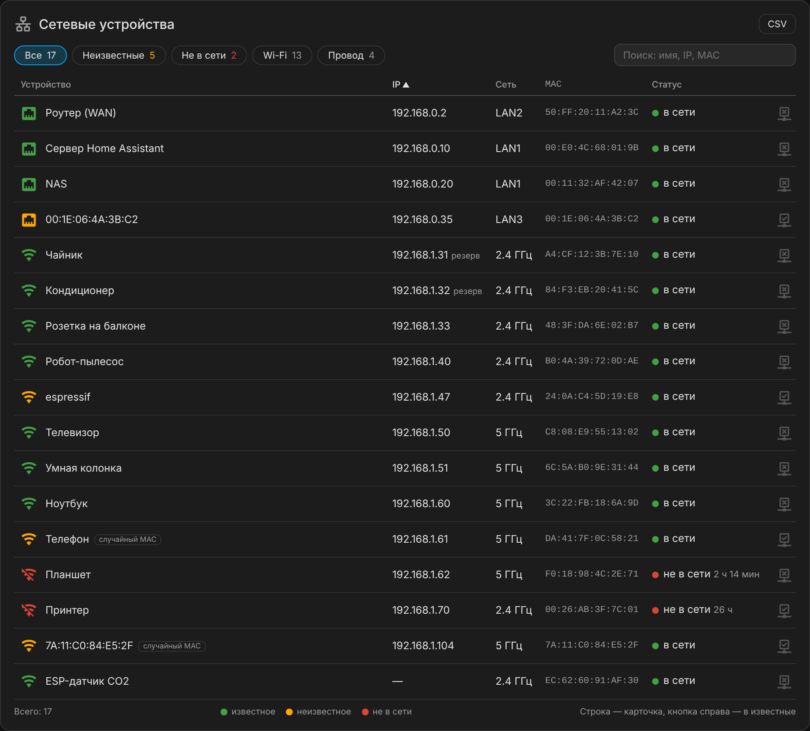
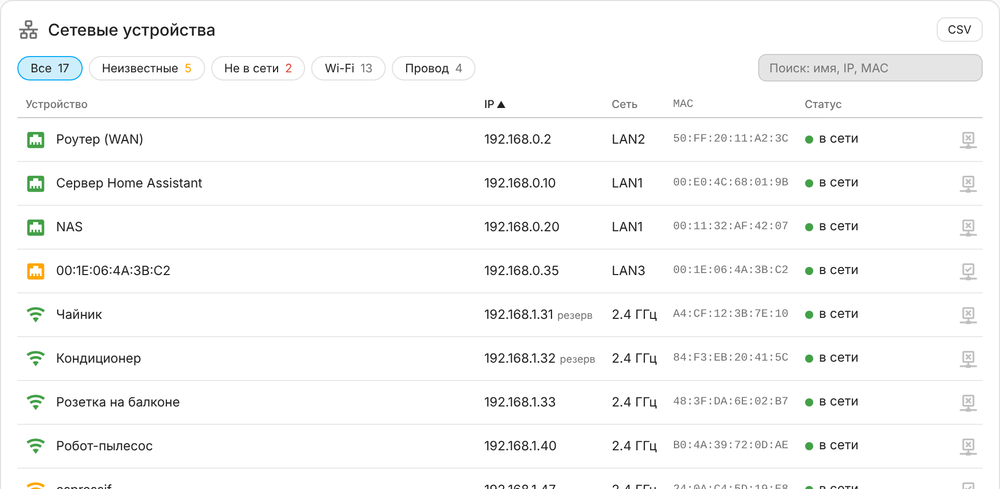
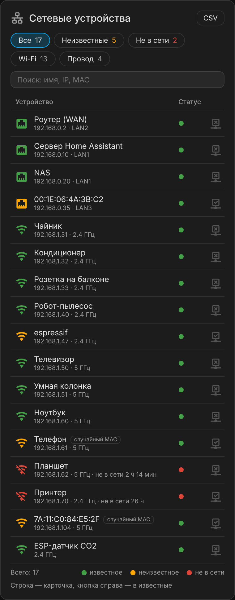
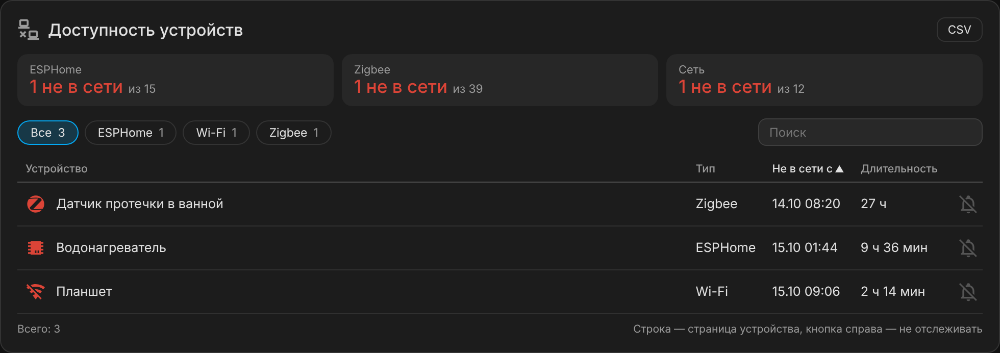

# Devices Table Card

[](https://hacs.xyz/)
[](https://github.com/Lordhmen/devices-table-card/releases)
[](https://github.com/Lordhmen/devices-table-card/actions/workflows/validate.yml)

Карточка Lovelace для Home Assistant: **таблица устройств** с сортировкой, фильтрами и поиском.

- **`network`** — сетевые устройства из трекеров (`device_tracker`): IP, Wi-Fi 2.4/5 ГГц или порт LAN, MAC, статус.
  Известные устройства отмечаются меткой, неизвестные подсвечиваются; пометить устройство можно кнопкой прямо в строке.
- **`availability`** — устройства «не в сети» из списка в атрибуте сенсора, плитки «в сети / всего» по источникам
  (ESPHome, Zigbee, сеть…), кнопка «не отслеживать».



Сестринский проект [stats-table-card](https://github.com/Lordhmen/stats-table-card): тот же стиль, один JS-файл без зависимостей.

## Возможности

- Сортировка по клику на заголовок, IP сортируется численно (`.5` → `.10` → `.202`), устройства без IP — в конце.
- Фильтры-чипы со счётчиками: «Неизвестные», «Не в сети», «Wi-Fi», «Провод»; в режиме `availability` — по типу устройства.
- Поиск по имени, IP и MAC.
- IP из статических DHCP-резерваций, если у устройства нет аренды (`reservations_entity`), с пометкой «резерв».
- Пометка случайных (локально администрируемых) MAC — обычно это телефоны с приватным адресом.
- Клик по строке открывает карточку сущности или страницу устройства.
- Кнопка в строке ставит/снимает метку через реестр HA (только для администраторов).
- Экспорт видимых строк в CSV для Excel (разделитель `;`, UTF-8 с BOM).
- Тёмная и светлая темы через CSS-переменные HA; на узкой карточке IP и сеть переходят под имя.

| Светлая тема | Узкая карточка (телефон) |
|---|---|
|  |  |

Все скриншоты сняты с демо-страницы [`docs/demo.html`](docs/demo.html) на вымышленных данных.

## Установка

### HACS

1. HACS → ⋮ → **Пользовательские репозитории**.
2. Репозиторий `https://github.com/Lordhmen/devices-table-card`, тип **Dashboard**.
3. Установите **Devices Table Card** и обновите страницу с очисткой кэша (Ctrl+F5).

### Вручную

1. Скачайте `devices-table-card.js` со страницы [релизов](https://github.com/Lordhmen/devices-table-card/releases)
   и положите в `/config/www/devices-table-card.js`.
2. **Настройки → Панели → ⋮ → Ресурсы → Добавить ресурс**: URL `/local/devices-table-card.js?v=0.1.0`, тип **JavaScript-модуль**.

## Режим `network`

```yaml
type: custom:devices-table-card
mode: network
title: Сетевые устройства
icon: mdi:lan
platforms:
  - openwrt_ubus            # все трекеры этой интеграции
include:
  - device_tracker.lan_*    # и трекеры по маске entity_id
reservations_entity: sensor.openwrt_dhcp_reservations
known_label: izvestnoe_ustroistvo
```

Что берётся из атрибутов трекера:

| Атрибут | Колонка |
|---|---|
| `ip` | IP (`Unknown IP` считается пустым) |
| `mac` | MAC, поиск по `reservations_entity` |
| `ssid` | «5 ГГц», если SSID заканчивается на `5`, `5.0`, `5G`; иначе «2.4 ГГц» |
| `connection_type: wired` или `entity_id` вида `device_tracker.lan_*` | проводное устройство, колонка «Сеть» = `port` |

`reservations_entity` — сенсор с атрибутом `hosts`: `{"AA:BB:CC:DD:EE:FF": {"ip": "192.168.1.10", "name": "…"}}`.

## Режим `availability`



```yaml
type: custom:devices-table-card
mode: availability
title: Доступность устройств
entity: sensor.offline_devices
ignore_label: ne_otslezhivat_dostupnost
sources:
  - name: ESPHome
    platform: esphome
  - name: Zigbee
    include: sensor.*_last_seen
  - name: Сеть
    kinds: [Wi-Fi, LAN]
    label: izvestnoe_ustroistvo
    domain: device_tracker
    count: entities
```

Сенсор `entity` хранит в атрибуте (`attribute`, по умолчанию `devices`) список:

```json
[{"key": "<device_id | entity_id | hub:…>", "name": "Water Heater 2", "kind": "ESPHome", "since": "2026-10-14T19:44:36+00:00"}]
```

- `key` из 32 hex-символов — `device_id`: клик открывает страницу устройства, кнопка ставит метку на устройство.
- `key` с точкой — `entity_id`: клик открывает карточку сущности.
- `key` с префиксом `hub:` — шлюз, без действий.

`sources` — плитки над таблицей. Для каждой считается «всего» и «не в сети» (строки, у которых `kind` входит в `kinds`, по умолчанию `[name]`):

| Ключ | Что считает |
|---|---|
| `platform` | сущности интеграции |
| `include` | сущности по маске `entity_id` (строка или список) |
| `label` (+ `domain`) | сущности с меткой |
| `count` | `devices` (по умолчанию, уникальные устройства) или `entities` |

## Параметры

| Параметр | По умолчанию | Описание |
|---|---|---|
| `mode` | `network` | `network` или `availability` |
| `title`, `icon` | — | Заголовок и иконка |
| `platforms` | `[openwrt_ubus]` | `network`: интеграции трекеров |
| `include` / `exclude` | `[device_tracker.lan_*]` / `[]` | `network`: маски `entity_id` |
| `reservations_entity` | — | `network`: сенсор с DHCP-резервациями |
| `known_label` | `izvestnoe_ustroistvo` | `network`: метка «известное устройство» |
| `entity`, `attribute` | —, `devices` | `availability`: сенсор и атрибут со списком |
| `ignore_label` | `ne_otslezhivat_dostupnost` | `availability`: метка «не отслеживать» |
| `sources` | — | `availability`: плитки по источникам |
| `sort`, `sort_desc` | `ip` / `since`, `false` | Колонка и направление сортировки при открытии |
| `default_filter` | `all` | Фильтр при открытии (`unknown`, `offline`, `wifi`, `lan`) |
| `actions` | `true` | Кнопка метки в строке (видна только администраторам) |
| `search`, `csv` | `true` | Поиск и кнопка CSV |
| `empty_text` | — | Текст при пустом списке |
| `font_size` | `.9em` | Размер шрифта таблицы |
| `time_zone` | часовой пояс HA | Для дат «не в сети с» |

## Разработка

```bash
node --check devices-table-card.js
node --test tests/*.test.mjs
python3 -m http.server   # затем открыть /docs/demo.html — демо без Home Assistant
                         # параметры: ?view=availability, ?theme=light, ?width=380
```

Релиз собирается автоматически: поднимите `DTC_VERSION` в `devices-table-card.js`, допишите `CHANGELOG.md` и отправьте в `main`.

## Лицензия

MIT
